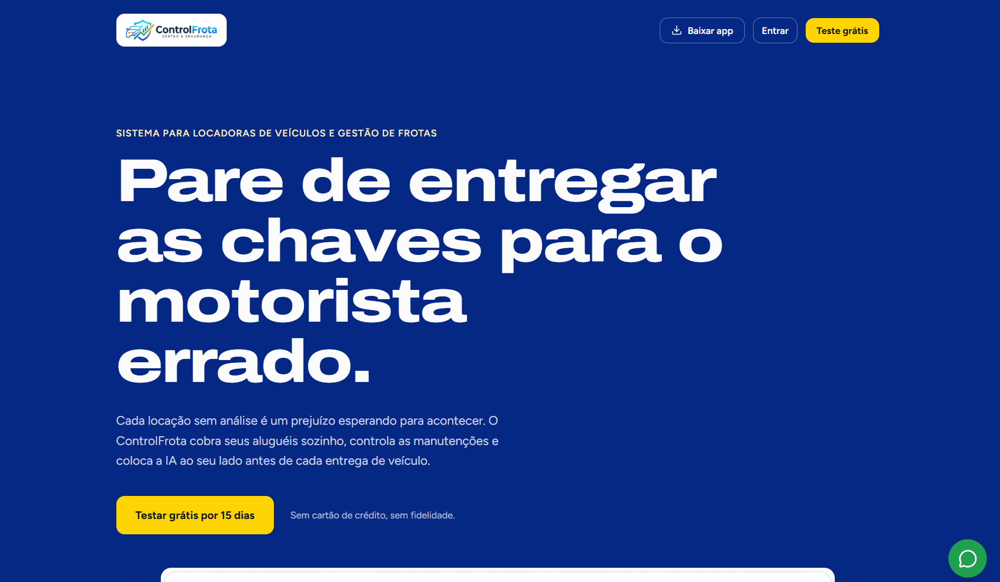
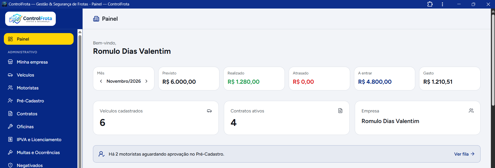
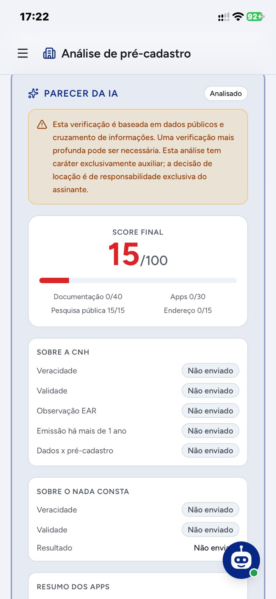
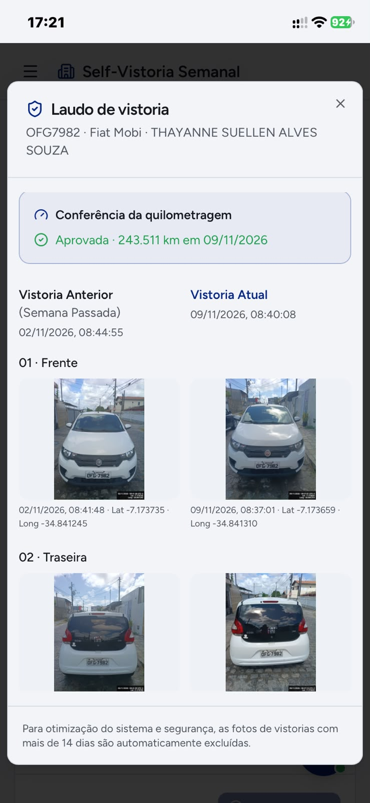
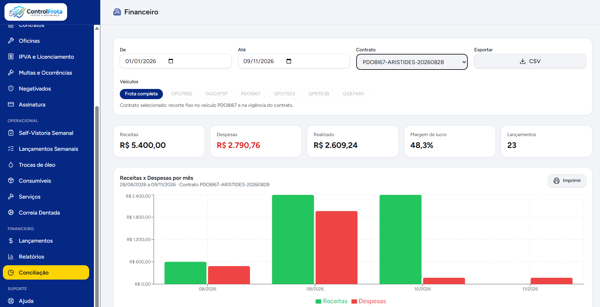
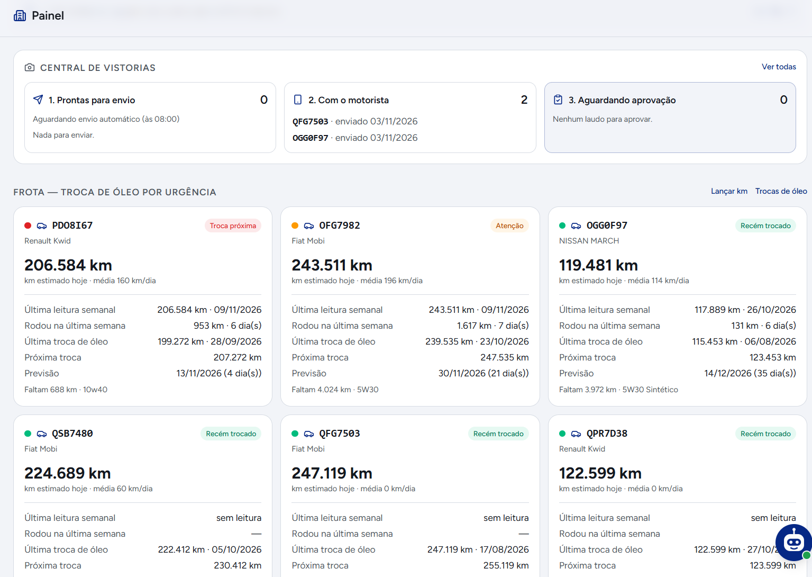

# ControlFrota — Plataforma SaaS de Gestão de Frotas e Locadoras

Plataforma SaaS multi-tenant desenvolvida para digitalização de ponta a ponta na operação de locadoras de veículos e gestão de frotas comerciais. A solução centraliza contratos, automação de cobranças bancárias, motor de triagem cadastral antifraude para CNHs via visão computacional, self-vistoria semanal com validação geoespacial e assistente operacional integrado ao WhatsApp.

Desenvolvido e mantido por Romulo Valentim como projeto de arquitetura de software, automação de fluxos críticos e engenharia de produto.

---

## Demonstrativo Visual da Plataforma

As capturas de tela abaixo ilustram a interface da plataforma, abrangendo desde a presença pública de conversão até as rotinas operacionais e analíticas restritas às locadoras.

### 1. Landing Page Institucional e Conversão
Interface pública focada em proposta de valor, apresentação dos planos de assinatura, micro-SaaS de Score IA e conversão direta para PWA.


### 2. Painel Executivo e Visão de Frota
Painel consolidado com indicadores de taxa de ocupação, contratos ativos, veículos em manutenção, alertas de vistoria e faturamento semanal.


### 3. Motor de Triagem Cadastral e Análise Antifraude
Pipeline de leitura e validação documental de condutores com inspeção de fontes tipográficas, divergência de categorias, bloqueio de PPD com EAR e análise de litígios em tribunais.


### 4. Self-Vistoria Semanal do Condutor
Fluxo mobile com captura sequencial de nove fotos obrigatórias, carimbo imutável de data/hora, geolocalização forçada via GPS e política estrita de retenção de armazenamento.


### 5. Gestão Financeira e Conciliação de Cobranças
Controle de cobranças semanais automatizadas, conciliação por webhook com travas transacionais e distinção contábil entre taxa de adesão e caução contratual.


### 6. Assistente Operacional e Mensageria
Interface de comando operacional integrada a canais de mensageria para consulta de métricas de frota, acionamento de vistorias e registro de despesas com confirmação obrigatória de transações.


---

## O Problema de Negócio e a Solução de Engenharia

O segmento de locação de veículos de pequeno e médio porte opera tradicionalmente sob processos manuais e alta exposição ao risco:

* Risco de inadimplência e apropriação indébita por triagens cadastrais manuais que falham na identificação de CNHs adulteradas ou condutores com pendências judiciais em múltiplos estados.
* Depreciação acelerada dos ativos pela falta de rotina estruturada de vistorias periódicas entre o início e o término de contratos de longo prazo.
* Gargalos operacionais na cobrança manual de locações semanais via transferência bancária, com conciliação propensa a inconsistências contábeis.
* Fricção no atendimento a condutores em trânsito, que demandam canais imediatos via smartphone sem necessidade de acesso a painéis desktop complexos.

O ControlFrota soluciona esses eixos por meio de uma arquitetura baseada em eventos, validação estrita de dados no servidor e isolamento multi-inquilino.

---

## Arquitetura de Software e Engenharia do Sistema

A aplicação foi estruturada segundo o modelo Full Stack Moderno, priorizando renderização orientada a rotas, segurança declarativa no banco de dados e execução em borda (*Edge Functions*).

```text
[ Cliente Web / PWA ] (React 19 + TanStack Start + Tailwind CSS)
          │
          │ HTTPS / Server Functions (Tipagem de ponta a ponta via Zod)
          ▼
[ Camada de Aplicação / Edge Runtime ]
    ├── Autenticação e Gestão de Sessões
    ├── Validações de Negócio e Criptografia
    ├── Pipeline Multimodal de Triagem Documental
    └── Motor Transacional com Locks Distribuídos
          │
          ├── [ PostgreSQL com Row Level Security (RLS) ]
          │     ├── Isolamento Multi-tenant Estrito por Locadora
          │     └── Funções RPC e Triggers de Integridade
          │
          ├── [ Gateway Financeiro Assas ] ◄── Webhooks com Verificação de Assinatura
          │
          └── [ Orquestrador n8n + Evolution API ] ◄── Mensageria WhatsApp
